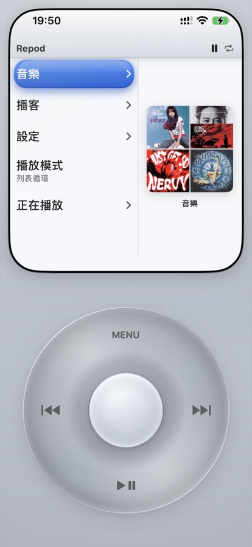
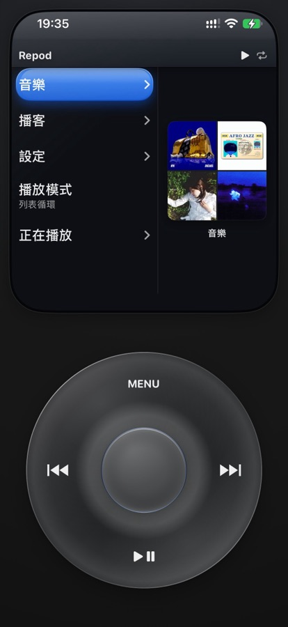
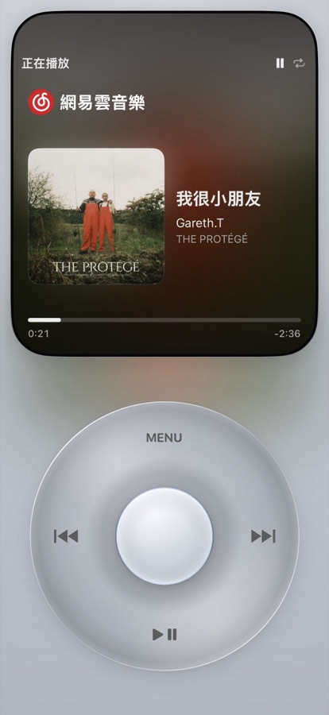
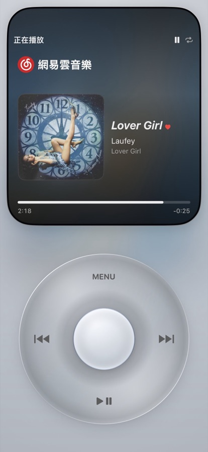
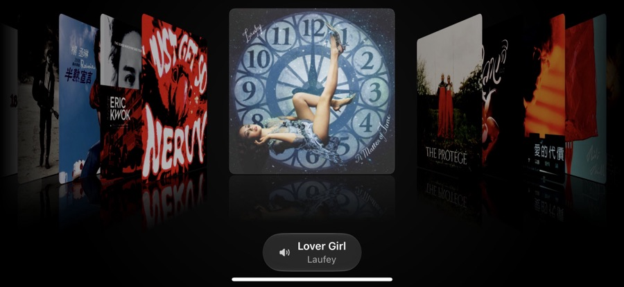

# Repod (iPodPlayer)

**English** | [中文](#中文)

An iPod Classic–style music player for iOS, written in SwiftUI: a click wheel with haptic ticks, Cover Flow in landscape, and now-playing on the lock screen / Control Center / Dynamic Island. Two sources:

- **NetEase Cloud Music** — talks to `music.163.com` from the phone itself. Since 3.0 it needs **no server at all**: request signing, cookies and scrobbling happen in the app. If you already run your own [NeteaseCloudMusicApi](https://www.npmjs.com/package/NeteaseCloudMusicApi), you can switch to that gateway instead.
- **Spotify** — controls the Spotify app through the Spotify iOS SDK, using **your own** Spotify Client ID entered in Settings.

Requires iOS 17.0+.

> **This project provides no server, no account and no credentials.** Your NetEase login cookie stays in the iOS Keychain on your device; your Spotify Client ID is entered by you and stored locally.

## Screenshots

<p align="center">
  
  
  
  
</p>
<p align="center">
  
</p>

## Features

- Click wheel: scroll with acceleration, select, menu, play/pause, previous/next, haptics throughout
- Cover Flow album browsing in landscape, with album reflections
- Search, artists, albums, playlists, daily recommendations, personal FM, podcasts and liked songs
- NetEase direct mode: `weapi` / `eapi` requests are signed on the device, QR login as a desktop client, play scrobbling through `clientlog`
- Optional gateway mode for an existing NeteaseCloudMusicApi deployment
- Spotify playback control via App Remote + Web API (PKCE, no client secret)
- Five body colors (white, silver, black, mint, sunset) with independent light/dark screens
- Lock screen / Control Center / Dynamic Island now-playing, artwork tilt in Now Playing
- English, Simplified Chinese and Traditional Chinese UI
- Unit tests for the request signing, cookie jar and connection-mode logic

## Install the prebuilt .ipa (sideloading)

1. Download `Repod-x.y.z.ipa` (unsigned) from [Releases](../../releases).
2. Install it with [SideStore](https://sidestore.io) (My Apps → `+` → pick the `.ipa`), AltStore, or any re-signing tool. It will be signed with your own Apple ID.
3. Free Apple IDs need to refresh the app every 7 days in SideStore.

## NetEase Cloud Music

### Default: direct connection (no server)

1. Open the app → **设置 → 网易云设置 → 连接方式** and pick **直连官方接口** — this is the default when no server address is set.
2. Scan the QR code to log in. Since 3.1.12 the login uses a desktop-client identity (`eapi`), because NetEase no longer accepts the old web QR login.

Logging in is what unlocks liked songs, your playlists, VIP tracks and play history. Everything is sent from your phone's own IP; nothing is proxied.

### Optional: your own NeteaseCloudMusicApi gateway

The gateway path from 2.x still works. It is useful if you want one shared server for several devices, or you prefer traffic to leave from a host you control.

- **Node.js (18+)**: `npx NeteaseCloudMusicApi@latest` (quick start), or clone it and run `PORT=3000 node app.js`
- **Docker**: `docker run -d --name ncm-api --restart unless-stopped -p 3000:3000 binaryify/netease_cloud_music_api`

**Your phone must be able to reach that address** — same LAN (e.g. `http://192.168.1.10:3000`), a public host you control (put it behind a firewall / auth), or your own tunnel / VPN. Open the address in the phone's browser first to check. Then set **连接方式 → 自建网关** and enter the address in **网易云服务地址**.

#### Optional patch: working scrobbles on the gateway

The stock `/scrobble` endpoint returns success but NetEase no longer records the play ("Recently played" / "Listening ranking" stay unchanged). [`patches/NeteaseCloudMusicApi/module/scrobble.js`](patches/NeteaseCloudMusicApi/module/scrobble.js) is a drop-in replacement that reports `startplay` + `play` via eapi to `clientlog.music.163.com` and returns real errors instead of fake success. Direct mode does not need this patch; only gateway mode does.

```sh
cd <your NeteaseCloudMusicApi directory>          # needs util/option.js (4.x / api-enhanced)
cp module/scrobble.js module/scrobble.js.bak
cp /path/to/Repod/patches/NeteaseCloudMusicApi/module/scrobble.js module/scrobble.js
node --check module/scrobble.js
# restart: pm2 restart <name> / systemctl restart <service> / re-run node app.js
```

For Docker, bind-mount the file (e.g. `-v $PWD/scrobble.js:/app/module/scrobble.js`; check your image's app path) and restart the container. The `npx` method cannot be patched — use a clone.

## Spotify (optional)

1. Create an app in the [Spotify Developer Dashboard](https://developer.spotify.com/dashboard) (iOS SDK + Web API).
2. Register the redirect URI `ipodplayer://spotify-login-callback`.
3. Enter your Client ID in the app's **Settings → Spotify**. It is stored in the app's preferences on the device — there is no build-time Client ID to bake in.

## Build from source

```sh
git clone <this repo> && cd <repo>
cp Config/Secrets.example.xcconfig Config/Secrets.xcconfig   # git-ignored
# edit Config/Secrets.xcconfig: DEVELOPMENT_TEAM, PRODUCT_BUNDLE_IDENTIFIER
open iPodPlayer.xcodeproj
```

- `Config/Base.xcconfig` holds safe defaults (`com.example.repod`, empty team) and optionally includes `Config/Secrets.xcconfig`. The project builds without the secrets file.
- The Spotify iOS SDK is fetched automatically by Swift Package Manager.
- Unit tests: `xcodebuild test -project iPodPlayer.xcodeproj -scheme iPodPlayer -destination 'platform=iOS Simulator,name=iPhone 17 Pro'`. A few probes that hit the real NetEase endpoints skip themselves when there is no network.

Unsigned `.ipa`:

```sh
xcodebuild -project iPodPlayer.xcodeproj -scheme iPodPlayer -configuration Release \
  -destination 'generic/platform=iOS' -archivePath build/iPodPlayer.xcarchive archive \
  CODE_SIGNING_ALLOWED=NO CODE_SIGNING_REQUIRED=NO CODE_SIGN_IDENTITY=""
mkdir -p build/Payload && cp -R build/iPodPlayer.xcarchive/Products/Applications/*.app build/Payload/
(cd build && zip -qry Repod.ipa Payload)
```

## Disclaimer

This project is **not an official NetEase Cloud Music client** and is not affiliated with NetEase, Apple, or Spotify. NetEase support relies on unofficial APIs, whether called directly or through a third-party gateway. **Using unofficial APIs may get your account restricted or banned; you use it entirely at your own risk.** Respect each platform's terms of service and only play content you are entitled to.

## Contributing

See [CONTRIBUTING.md](CONTRIBUTING.md). Issues and PRs are welcome.

## License

[MIT](LICENSE) © 2026 Haoyu Qiu

---

## 中文

一个 iPod Classic 风格的 iOS 音乐播放器（SwiftUI）：带触感反馈的点按式转盘、横屏 Cover Flow、锁屏 / 控制中心 / 灵动岛播放控制。两种音源：

- **网易云音乐**：手机直接连 `music.163.com`。3.0 起**不需要任何服务器**，签名、Cookie、听歌打卡都在 App 内完成。如果你已经有自建的 [NeteaseCloudMusicApi](https://www.npmjs.com/package/NeteaseCloudMusicApi)，也可以切回网关模式。
- **Spotify**：通过 Spotify iOS SDK 控制 Spotify App，用**你自己的** Client ID（在设置里填写）。

要求 iOS 17.0+。

> **本项目不提供任何服务器、账号或凭证。** 网易云登录 Cookie 只存在你手机的钥匙串里，Spotify Client ID 由你自己填写并保存在本地。

### 截图

见上方截图：浅色银色机身、深色午夜机身、两版正在播放、横屏 Cover Flow。需要替换时把图片放进 `docs/screenshots/` 并按同名覆盖即可。

### 安装 .ipa（侧载）

1. 在 [Releases](../../releases) 下载未签名的 `Repod-x.y.z.ipa`
2. 用 [SideStore](https://sidestore.io)（My Apps → `+` → 选择 `.ipa`）、AltStore 或其他自签工具安装，会用你自己的 Apple ID 签名
3. 免费 Apple ID 需每 7 天在 SideStore 里刷新一次

### 网易云音乐

**默认：直连（不需要服务器）**

1. 打开 App →「设置 → 网易云设置 → 连接方式」，选择「直连官方接口」。没有填过服务地址时这就是默认值。
2. 扫码登录。3.1.12 起改用 PC 客户端身份（eapi）登录，因为网易云已经不再接受旧的网页扫码登录。

登录之后才有红心歌曲、自己的歌单、会员曲目和听歌记录。所有请求都从手机自己的 IP 发出，不经过任何中转。

**可选：自建 NeteaseCloudMusicApi 网关**

2.x 的网关模式仍然保留，适合多台设备共用一个服务，或希望流量从自己的主机出去。

- **Node（18+）**：`npx NeteaseCloudMusicApi@latest`；或 clone 后 `PORT=3000 node app.js`
- **Docker**：`docker run -d --name ncm-api --restart unless-stopped -p 3000:3000 binaryify/netease_cloud_music_api`

**手机必须能访问该地址**：同一局域网、你自己的公网主机（建议加防火墙/认证），或你自己的隧道 / VPN。先用手机浏览器打开确认能访问。然后在「连接方式」选「自建网关」，把地址填进「网易云服务地址」。

**可选补丁：修复网关模式的听歌打卡**

原版 `/scrobble` 返回成功但网易云不入账。把 [`patches/NeteaseCloudMusicApi/module/scrobble.js`](patches/NeteaseCloudMusicApi/module/scrobble.js) 覆盖到你的 NeteaseCloudMusicApi 的 `module/` 目录（先备份原文件，`node --check` 检查语法），然后重启服务即可；Docker 部署请用 `-v` 挂载该文件后重启容器，`npx` 方式无法打补丁。直连模式不需要这个补丁。

### Spotify（可选）

1. 在 [Spotify Developer Dashboard](https://developer.spotify.com/dashboard) 建一个应用（iOS SDK + Web API）
2. 注册回调 URI `ipodplayer://spotify-login-callback`
3. 在 App「设置 → Spotify」填入 Client ID。它只保存在设备的应用偏好里，没有编译期的默认值。

### 从源码构建

复制 `Config/Secrets.example.xcconfig` 为 `Config/Secrets.xcconfig`（已被 git 忽略），填入你自己的 `DEVELOPMENT_TEAM`、`PRODUCT_BUNDLE_IDENTIFIER`。不建这个文件也能编译。Spotify SDK 由 SPM 自动拉取。

单元测试：`xcodebuild test -project iPodPlayer.xcodeproj -scheme iPodPlayer -destination 'platform=iOS Simulator,name=iPhone 17 Pro'`。少数真连网易云的探针在没有网络时会自动跳过。

未签名 `.ipa`：见上方英文部分的命令；把 `Repod.ipa` 换成你要的名字即可。

### 免责声明

本项目**不是网易云音乐官方客户端**，与网易云音乐、Apple、Spotify 无任何关联。网易云音源依赖非官方接口——无论是直连还是走第三方网关。**使用非官方接口存在账号被限制或封禁的风险，后果由使用者自行承担**。本项目不提供任何公共服务。请遵守各平台服务条款，仅播放你有权收听的内容。

### 贡献

见 [CONTRIBUTING.md](CONTRIBUTING.md)。

### 许可证

[MIT](LICENSE) © 2026 Haoyu Qiu
